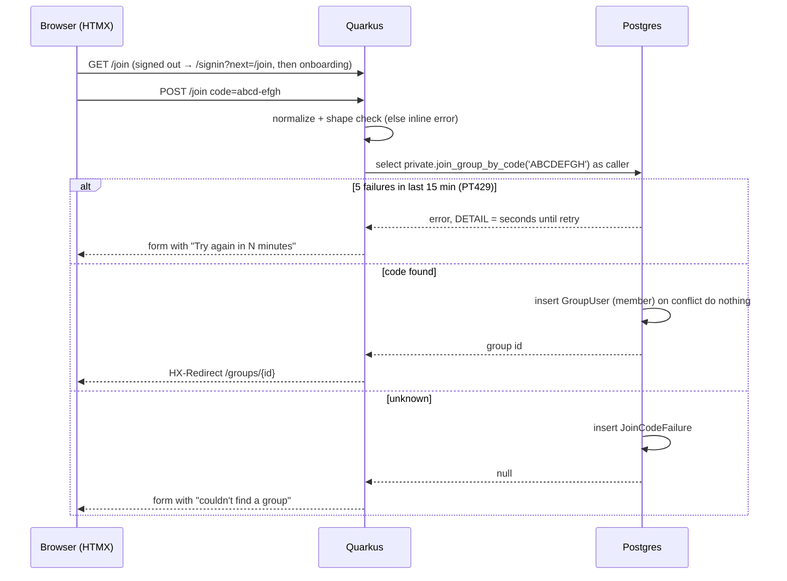
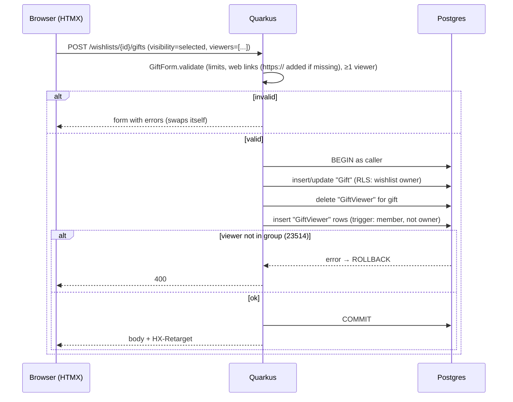
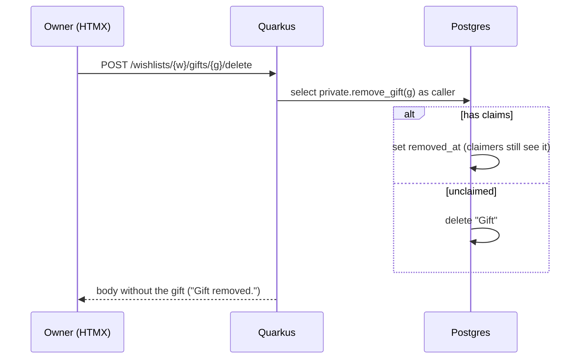
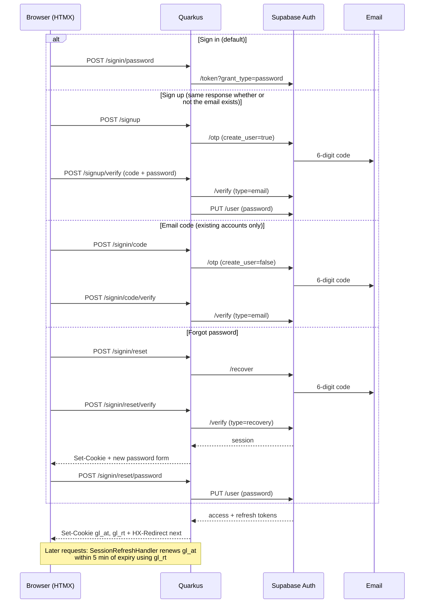

# Overview
- `web/` — Quarkus 3.40 (Java 25 target), Qute server-rendered HTML + HTMX, JSON API under `/api`.
- `database/` — Supabase (Postgres, Auth). Schema and RLS owned by Supabase migrations.

# Frontend Responsibilities
Qute templates (`web/src/main/resources/templates/`) render full pages; HTMX
requests fragment endpoints (`/fragments/...`) and swaps them in. HTMX is served
locally from the `org.mvnpm:htmx.org` jar at `/_static/htmx.org/dist/htmx.min.js`.
Styles and fonts are static files under `/assets/` (see `docs/DESIGN.md`).

# Backend Responsibilities
Quarkus REST resources, grouped by feature package (`com.giftloop.<feature>`).
Business rules that protect data live in Postgres (RLS + triggers); Java handles
request handling, validation for UX, and rendering.

# API Structure
APIs follow REST conventions under `/api`. OpenAPI at `/q/openapi`, Swagger UI
at `/q/swagger-ui` (dev/test only).

# Database Access Patterns
Plain JDBC via Agroal ([ADR 002](decisions/002-jdbc-with-transaction-scoped-rls.md)).
All user-facing queries go through `RlsContext.inUserTransaction(jwt, work)`,
which sets the caller's JWT claims and the `authenticated` role for the
transaction so RLS applies.

```mermaid
sequenceDiagram
  participant B as Browser / client
  participant Q as Quarkus
  participant A as Supabase Auth
  participant P as Postgres
  B->>A: sign in (email/password)
  A-->>B: access token (ES256 JWT)
  B->>Q: GET /api/me (Authorization: Bearer)
  Q->>A: fetch JWKS (cached)
  Q->>Q: verify signature, iss, aud
  Q->>P: BEGIN; set_config('request.jwt.claims', ...); SET LOCAL ROLE authenticated
  Q->>P: select ... (RLS uses auth.uid())
  P-->>Q: only rows the user may see
  Q->>P: COMMIT (role/claims reset)
  Q-->>B: 200 JSON
```

## Groups
`com.giftloop.group`: `GroupPageResource` (HTML), `GroupResource` (JSON reads),
`GroupService` (SQL via `RlsContext`). Group page actions post via HTMX and
swap the refreshed `#group-body`; leave/delete redirect home. Permission rules
live in RLS and `private.*` functions; Java only hides actions the user can't take.


## Events and Wishlists
`com.giftloop.event`: `EventPageResource` (create from the group page, event
page listing wishlists) and `EventService`. `com.giftloop.wishlist`:
`WishlistPageResource` (HTML), `WishlistResource` (JSON reads),
`WishlistService`. Gift forms swap themselves on validation errors; on success
the server sends `HX-Retarget: #wishlist-body` with the refreshed body.

Saving a gift writes the gift and its viewer allowlist in one transaction, so
visibility never lags the gift. RLS decides who can see it (see
`docs/DATABASE.md` → Gift Visibility).


## Claims
`com.giftloop.claim`: `ClaimPageResource` (HTML: `/claims` and claim actions
under `/wishlists/{w}/gifts/{g}/claims`), `ClaimResource` (`GET /api/claims`),
`ClaimService`, and `ClaimQueries` (claim reads shared with `WishlistService` in
the same transaction). Claim actions re-render the gift card (`#gift-<id>`,
outerHTML); on My claims they post `view=claims` and swap `#claims-body`.
`claim` depends on `wishlist` to re-render cards, and `wishlist` uses `claim`
records: a deliberate two-way package dependency.

Wishlist claim filters (`GiftFilter`) run in Java on the loaded gifts. Filter
links `hx-get /wishlists/{id}/body?show=…` and push `?show=` to the URL; gift
edits keep it via `HX-Current-URL`. While claims are hidden from the caller, any
`show` value is treated as "all", so filtering can't hint at claims.

`WishlistService.find` loads claims for members, and for the owner only once
revealed (`end_date < current_date` or `Group.is_claims_visible_to_owner`). Before
that the owner's gifts carry no claim data (`Gift.claims == null`), so "hidden"
never reads as "unclaimed".
```mermaid
sequenceDiagram
  participant B as Browser (HTMX)
  participant Q as Quarkus
  participant P as Postgres
  B->>Q: POST /wishlists/{w}/gifts/{g}/claims (quantity, anonymous)
  Q->>Q: ClaimForm.validate (1..999; over-claim confirmed in the UI)
  Q->>P: BEGIN as caller
  Q->>P: insert "Claim" (RLS: can_claim_gift; trigger: member, not owner, live gift)
  P->>P: trigger adds caller as ClaimParticipant
  opt anonymous
    Q->>P: update own ClaimParticipant set is_anonymous
  end
  Q->>P: COMMIT (name never visible un-anonymized)
  Q-->>B: refreshed #gift-<id> card
```

Marking units bought (`POST …/claims/{c}/purchased`) calls
`private.set_claim_purchased` as the caller, so co-buyers can set it without an
update grant on `Claim` (which would let them change `quantity`).

Owners remove gifts through `private.remove_gift` / `remove_wishlist` (see
`docs/DATABASE.md` → Gift Removal); the response is the same whether the gift
was claimed or not.


# Error Handling
SQL failures in `RlsContext` are rethrown as `DataAccessException` (500).
Expected rule outcomes (SQLSTATE class 23, `42501`, `P0002`, `PT429`) are logged at
DEBUG and mapped by the calling service (e.g. `42501` → 403). Missing/invalid tokens return 401 via SmallRye JWT.

# Authorization Boundaries
- Authentication: Supabase Auth issues JWTs; Quarkus verifies via JWKS.
- Authorization: Postgres RLS ([ADR 001](decisions/001-rls-with-user-jwt.md)).
  Java code must not bypass `RlsContext` for user data.
- Browser sessions use HttpOnly cookies ([ADR 003](decisions/003-cookie-sessions.md));
  API clients may send `Authorization: Bearer`.
- Pages marked `@RequiresOnboarding` send signed-in users without a finished
  profile to `/onboarding`.

## Sign-in
Pages: `/signin` (email + password), `/signup`, `/signin/code`, `/signin/reset`.
Each form posts via HTMX and swaps errors/next steps into `#auth-step`.


# Third-party Integrations
The app will need to utilize other authentication methods, or integrate with
Supabase's integrations with Apple, Google, etc.

Resend or other email providers will need to be utilized.

To be determined.
