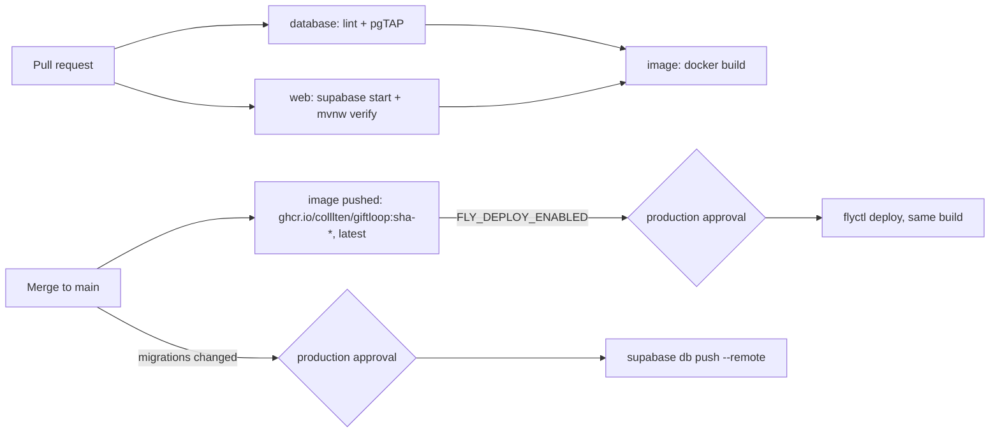

# CI/CD
GitHub Actions, in `.github/`. `main` publishes an image and, once enabled,
deploys it to Fly.io. Launch steps: [DEPLOYMENT.md](DEPLOYMENT.md).

| Workflow | Trigger | Does |
|---|---|---|
| `ci.yml` | PR, push to `main` | DB lint + pgTAP; `./mvnw verify` against local Supabase; builds `Dockerfile.jvm` (pushes to GHCR on `main`); `deploy` to Fly.io on `main` after approval (opt-in) |
| `deploy-db.yml` | push to `main` touching `migrations/`, manual | `supabase db push --remote` to prod after approval |
| `codeql.yml` | PR, push to `main`, weekly | Java static analysis |
| `dependabot.yml` | weekly | Maven, Actions, Docker base image updates |

## Notes
- CI starts Supabase with unused services excluded (`SUPABASE_EXCLUDE` in
  `ci.yml`). If a test starts needing one, remove it from the list.
- Supabase CLI is pinned (`3.4.0`) in both workflows; bump together. v3
  commands target the local stack by default, so anything aimed at prod needs
  `--remote` (and `--yes` for changes, since CI can't answer prompts).
- `deploy-db` runs after merge, so it relies on CI passing on the PR. Seed data
  is never pushed. Migrations deploy independently of the app, so keep them
  backward compatible with the running version.
- `deploy` reuses the tested `quarkus-app` artifact and builds the image on the
  runner (`--local-only`, no Fly builder), pushing to Fly's registry. It is
  skipped unless the repo variable `FLY_DEPLOY_ENABLED` is `true`.

## Runtime environment
Production needs the `SUPABASE_*` variables (Fly secrets, see
[DEPLOYMENT.md](DEPLOYMENT.md#3-fly-app)). `GIFTLOOP_CONTACT_EMAIL` optionally
overrides the legal contact (default `giftloopsupport@gmail.com`).

Port 8080 serves the app; port 9000 is the management interface (`/q/health`,
`/q/metrics`). Point health checks and the Prometheus scraper at 9000 and never
expose it publicly (ADR 006).

## Repository setup (one-time)
- **Environment `production`**: required reviewer = repo owner. Secrets:
  `SUPABASE_ACCESS_TOKEN`, `SUPABASE_DB_PASSWORD`, `SUPABASE_PROJECT_ID`,
  `FLY_API_TOKEN` (`fly tokens create deploy`).
- **Repo variable** `FLY_DEPLOY_ENABLED=true` turns on the `deploy` job. Set it
  after the first manual deploy.
- **Branch protection on `main`**: require PRs and the checks
  `Database (lint + pgTAP)`, `Web (tests + package)`, `Container image`,
  `Analyze (java)`.
