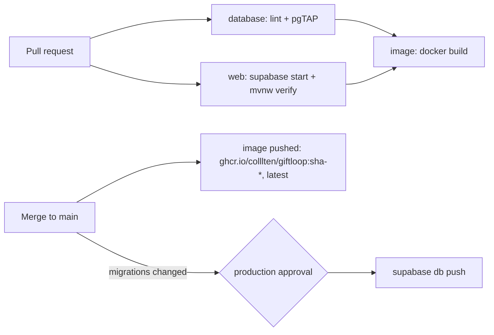

# CI/CD
GitHub Actions, in `.github/`. No app hosting yet; `main` publishes an image.

| Workflow | Trigger | Does |
|---|---|---|
| `ci.yml` | PR, push to `main` | DB lint + pgTAP; `./mvnw verify` against local Supabase; builds `Dockerfile.jvm` (pushes to GHCR on `main`) |
| `deploy-db.yml` | push to `main` touching `migrations/`, manual | `supabase db push` to prod after approval |
| `codeql.yml` | PR, push to `main`, weekly | Java static analysis |
| `dependabot.yml` | weekly | Maven, Actions, Docker base image updates |

## Notes
- CI starts Supabase with unused services excluded (`SUPABASE_EXCLUDE` in
  `ci.yml`). If a test starts needing one, remove it from the list.
- Supabase CLI is pinned (`2.106.0`) in both workflows; bump together.
- `deploy-db` runs after merge, so it relies on CI passing on the PR. Seed data
  is never pushed. Migrations deploy independently of the app, so keep them
  backward compatible with the running version.

## Repository setup (one-time)
- **Environment `production`**: required reviewer = repo owner. Secrets:
  `SUPABASE_ACCESS_TOKEN`, `SUPABASE_DB_PASSWORD`, `SUPABASE_PROJECT_ID`.
- **Branch protection on `main`**: require PRs and the checks
  `Database (lint + pgTAP)`, `Web (tests + package)`, `Container image`,
  `Analyze (java)`.
