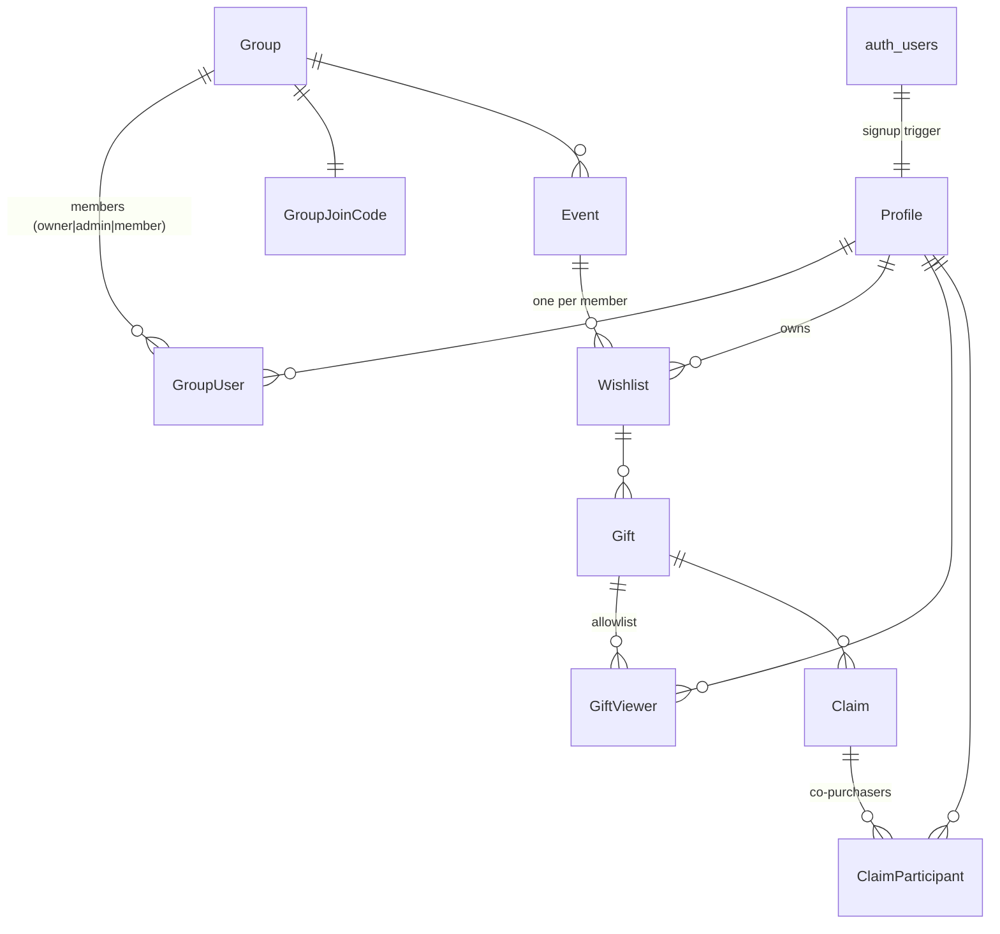

# Database

Supabase (Postgres 17). Project lives in `database/supabase/`.
Migrations: `database/supabase/migrations/`. Tests: `database/supabase/tests/` (pgTAP).

## Conventions
- Tables are TitleCase and singular, so they **must be double-quoted** in SQL:
  `select * from "Gift"`. Columns are snake_case.
- Access helpers and trigger functions live in the `private` schema, which is
  not exposed through the Data API.
- `anon` has no access. `authenticated` gets explicit grants only.

## Entity Relationship

| Table | Notes |
|---|---|
| `Profile` | 1:1 with `auth.users`. `username` citext, unique, `^[A-Za-z0-9_]{3,32}$`. `onboarded_at` set when onboarding finishes (requires `display_name`). Birthday is `birth_month`/`birth_day` only (no year). `avatar_path` = `<user id>/<file>` in the `avatars` bucket. |
| `Group` | `is_claims_visible_to_owner` lets owners see claims before the event ends. |
| `GroupUser` | Membership + `role` (`owner`, `admin`, `member`). Creator is auto-added as owner; at most one owner per group (partial unique index). No direct inserts: rows come from the creator trigger and `join_group_by_code`. |
| `GroupJoinCode` | One code per group, `^[A-HJ-NP-Z2-9]{8}$` (no I/O/0/1). Readable by owner/admins only. Created by trigger with the group. |
| `JoinCodeFailure` | One row per unknown join code entered (`user_id`, `failed_at`); guesses aren't stored. RLS on, no policies, no grants: only `join_group_by_code` uses it. Rows older than the window are pruned on the user's next attempt. |
| `Event` | `end_date` drives claim reveal. Null = never auto-reveal. |
| `Wishlist` | One live wishlist per (`event_id`, `owner_id`) (partial unique index). Owner must be a group member. `removed_at` set = removed shell kept for claimed gifts. `owner_id` is null only on removed shells whose owner deleted their account. |
| `Gift` | `quantity` ≥ 1. `price`, `links`, `notes` optional. `is_visible_to_all` (default true); when false, only `GiftViewer` rows can see it. `removed_at` set = owner removed it after it was claimed. `is_off_list` = a giver added it (see Off-list Gifts). `image_path` = `<owner id>/<gift id>/<file>` in `gift-images` (check: second segment is the gift's own id). |
| `GiftImageOrphan` | Gift photo files no gift points at (replaced, cleared or deleted). Filled by trigger; RLS on, no policies, no grants. Drained per owner by `take_gift_image_orphans()`. |
| `LinkPreviewAttempt` | One row per auto-fill attempt (`user_id`, `attempted_at`); links aren't stored. RLS on, no policies, no grants: only `record_link_preview` uses it. Rows older than the window are pruned on the user's next attempt. |
| `GiftViewer` | (`gift_id`, `user_id`) allowlist for restricted gifts. Owner-only read/write. Viewer must be a group member, not the owner (`23514`). Rows are dropped when the member leaves the group. |
| `Claim` | `quantity` units of a gift. Total claimed **may exceed** `Gift.quantity`. `purchased_quantity` (0..`quantity`) = units bought; set only via `private.set_claim_purchased`, by any participant. `created_by` is not readable via the API. |
| `ClaimParticipant` | Creator auto-added and can't leave (release the claim instead). Any participant can be `is_anonymous`. `joined_at` orders who inherits the claim. |
| `GiftClaimSummary` (view) | Per-gift `claim_count` / `claimed_quantity`, RLS applied (security_invoker). |

## Profiles & Avatars
- New auth users get a placeholder username from their email; they choose a
  real one during onboarding. `private.is_username_available(text)` checks
  uniqueness (case-insensitive) without exposing other profiles.
- `avatars` Storage bucket is private (2 MB, JPEG). Owners write under their
  own folder; owners and co-members can read (`storage.objects` policies).
- With `search_path = ''`, compare citext with `operator(extensions.=)`; a bare
  `=` silently falls back to case-sensitive text equality.

## Gift Images
- `gift-images` bucket: private, 1 MB, JPEG (the app re-encodes everything).
- Read: anyone who can read the gift row (policy subquery runs under the
  caller's Gift RLS), so claimers keep a removed gift's photo.
- Upload/update: own folder and `is_gift_owner(gift)`. Delete: own folder only,
  so files can go after the row is gone.
- Cleanup: the `queue_gift_image_orphan` trigger queues the old path whenever
  `image_path` changes or a gift row is deleted (including claim-release
  purges). After gift writes the app calls `private.take_gift_image_orphans()`
  and deletes the returned files through Storage as the owner.
- Auto-fill limit: the app calls `private.record_link_preview()` before each
  link preview. 20 attempts within 1 hour (sliding) → `PT429` with DETAIL =
  seconds until retry; blocked attempts aren't recorded.

## Group Membership
Functions in `private` (security definer, callable by `authenticated`):
- `join_group_by_code(code)` → group id. Ignores case, spaces and dashes.
  Unknown code records a `JoinCodeFailure` and returns null. Already a member:
  no change. 5 failures within 15 minutes (sliding) → every attempt, even a
  correct code, raises `PT429` with DETAIL = seconds until retry.
- `regenerate_join_code(group_id)` → new code. Owner/admin, else `42501`.
- `transfer_group_ownership(group_id, user_id)`. Owner only (`42501`); target
  must be another member (`23514`). Caller becomes admin.

Policies: owner/admin rename the group; only the owner deletes it or changes
roles (`admin` ↔ `member`). Delete on `GroupUser` allows leaving (not the
owner), owner removing anyone else, admins removing plain members.
`private.is_group_admin` counts the owner as an admin.

`Event`: any member creates; only the owner/admin updates (`name`, `end_date`)
or deletes, not the creator. Deleting cascades wishlists, gifts and claims.

## Gift Visibility
A member sees a gift if any of these hold (`private.gift_visible_to`):
- they own the wishlist;
- `is_visible_to_all` is true;
- they have a `GiftViewer` row;
- they take part in a claim on it. This keeps an item visible to claimers after
  the owner narrows the list, without telling the owner it was claimed.

Hidden gifts can't be claimed, and their claims stay hidden too
(`can_claim_gift` / `can_view_claims`). A claimer can't add a co-participant who
can't see the gift (`23514`), since that would grant them visibility.
Only the owner can read a gift's viewer list.

## Off-list Gifts
A giver records a gift that isn't on the owner's list. It is a `Gift` with
`is_off_list = true` (always shared with everyone, quantity 1) plus exactly one
`Claim` by the giver. `Claim.created_by` stays hidden, so anonymity works as usual.
- `private.add_off_list_gift(wishlist, name, price, links, notes)` → gift id.
  Live wishlist, caller a member and not the owner; else `42501`. Inserts the
  gift and the giver's claim.
- `private.update_off_list_gift(gift, name, price, links, notes)`. Claim
  creator of a live off-list gift only (`42501`).
- Owner: hidden until `claims_revealed_to_owner(wishlist)` (same rule as claim
  reveal), via `gift_visible_to`; the inline owner clause of the Gift read
  policy skips off-list rows. Owners can't insert, update, remove
  (`is_gift_owner` is false), restrict or upload photos for them.
- No other claims (`can_claim_gift` false; `validate_claim` raises `23514`).
- Releasing the claim deletes the gift (`purge_released_removed_gift`).
  `remove_wishlist` marks it removed like any claimed gift.

## Gift Removal
No direct `DELETE` on `Gift` or `Wishlist`. Owners call (security definer, 42501
unless the caller owns the live row):
- `private.remove_gift(gift_id)`: unclaimed → deleted; claimed → `removed_at`
  (viewer rows dropped).
- `private.remove_wishlist(wishlist_id)`: deletes unclaimed gifts, marks claimed
  ones removed; the wishlist becomes a removed shell only if any are left.

The owner can't tell removed from deleted: owner helpers (`is_wishlist_owner`,
`is_gift_owner`, `gift_visible_to`) ignore removed rows, and claiming a missing or
removed gift raises the same `23514` message. A re-created wishlist gets a new id.
Removed gifts stay visible to claim participants only and can't get new claims or
co-buyers. Releasing the last claim purges the gift, then an empty removed wishlist
(`purge_released_removed_gift` trigger).

## Claim Visibility
- Group members (non-owners) who can see a gift see all claims on it.
- The wishlist owner sees claims only when `Event.end_date < current_date` (UTC)
  or `Group.is_claims_visible_to_owner` is true.
- Anonymous participants are visible only to people on the same claim, even
  after reveal.
- Owners can't claim or co-purchase their own gifts. Participants must be group members.
- `purchased_quantity` is part of the claim, so it follows the same visibility.
  `private.set_claim_purchased(claim_id, n)` allows any participant (42501
  otherwise); out of range, or lowering `quantity` below it, is `23514`.

Because `Claim.created_by` is column-restricted, `select *` on `Claim` fails.
Select columns explicitly (`id, gift_id, quantity, created_at`) and use
`ClaimParticipant` for "who" / "my claims".

## Account Deletion
`private.delete_my_account(username)` (authenticated; `42501` signed out, `23514`
unless the username matches, ignoring case) deletes the caller's `auth.users` row.
The app first calls `transfer_group_ownership` for groups where the owner chose a
successor, in the same transaction.

`handle_profile_deleted` (before delete on `Profile`) runs for every auth-user
deletion, including Studio and the Admin API:
1. Owned groups pass to `pick_group_successor`: oldest admin, else oldest member
   (`joined_at`). No one else in the group → group deleted.
   `group_successor(group_id)` exposes the pick to the owner only.
2. Claims they created pass to the earliest co-buyer; solo claims are released.
3. Live wishlists go through `remove_wishlist_unchecked` (same as
   `remove_wishlist`). Shells lose their owner (`on delete set null`), so
   owner checks use `is distinct from auth.uid()`; the app shows "Former member".

## Known Gaps
- An admin who is also a wishlist owner can flip the reveal flag.
- Deleting an event or group still cascades its claims (everyone sees it go).
- Gift photos of a deleted account's removed shells orphan once purged (queue
  rows for an owner who can no longer drain them).
