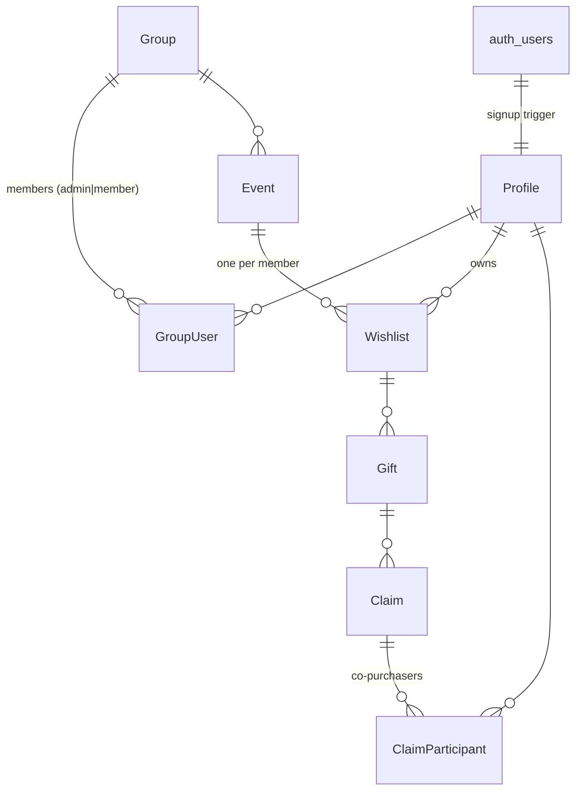

# Database

Supabase (Postgres 17). Project lives in `database/supabase/`.
Migrations: `database/supabase/migrations/`. Tests: `database/supabase/tests/` (pgTAP).

## Conventions
- Tables are TitleCase and singular, so they **must be double-quoted** in SQL:
  `select * from "Gift"`. Columns are snake_case.
- Access helpers and trigger functions live in the `private` schema, which is
  not exposed through the Data API.
- `anon` has no access. `authenticated` gets explicit grants only.

## Entity Relationship

| Table | Notes |
|---|---|
| `Profile` | 1:1 with `auth.users`. `username` citext, unique, `^[A-Za-z0-9_]{3,32}$`. `onboarded_at` set when onboarding finishes (requires `display_name`). Birthday is `birth_month`/`birth_day` only (no year). `avatar_path` = `<user id>/<file>` in the `avatars` bucket. |
| `Group` | `is_claims_visible_to_owner` lets owners see claims before the event ends. |
| `GroupUser` | Membership + `role` (`admin`, `member`). Group creator is auto-added as admin. |
| `Event` | `end_date` drives claim reveal. Null = never auto-reveal. |
| `Wishlist` | Unique per (`event_id`, `owner_id`). Owner must be a group member. |
| `Gift` | `quantity` ≥ 1. `price`, `links`, `notes` optional. |
| `Claim` | `quantity` units of a gift. Total claimed **may exceed** `Gift.quantity`. `created_by` is not readable via the API. |
| `ClaimParticipant` | Creator auto-added. Any participant can be `is_anonymous`. |
| `GiftClaimSummary` (view) | Per-gift `claim_count` / `claimed_quantity`, RLS applied (security_invoker). |

## Profiles & Avatars
- New auth users get a placeholder username from their email; they choose a
  real one during onboarding. `private.is_username_available(text)` checks
  uniqueness (case-insensitive) without exposing other profiles.
- `avatars` Storage bucket is private (2 MB, JPEG). Owners write under their
  own folder; owners and co-members can read (`storage.objects` policies).
- With `search_path = ''`, compare citext with `operator(extensions.=)`; a bare
  `=` silently falls back to case-sensitive text equality.

## Claim Visibility
- Group members (non-owners) see all claims on a gift.
- The wishlist owner sees claims only when `Event.end_date < current_date` (UTC)
  or `Group.is_claims_visible_to_owner` is true.
- Anonymous participants are visible only to people on the same claim, even
  after reveal.
- Owners can't claim or co-purchase their own gifts. Participants must be group members.

Because `Claim.created_by` is column-restricted, `select *` on `Claim` fails.
Select columns explicitly (`id, gift_id, quantity, created_at`) and use
`ClaimParticipant` for "who" / "my claims".

## Known Gaps
- No invite/join flow yet; admins add members directly to `GroupUser`.
- Nothing prevents removing or demoting a group's last admin.
- An admin who is also a wishlist owner can flip the reveal flag.
