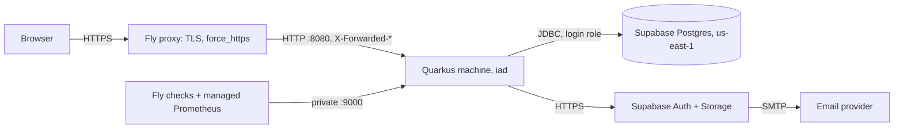

# Deployment Checklist
Steps to take GiftLoop live on **Fly.io** (app `giftloop`, region `iad`). Config:
`web/fly.toml`. CI builds and tests the image; the opt-in `deploy` job in
`ci.yml` ships it ([CICD.md](CICD.md)).



## 1. Supabase project
- [ ] Create the production project in **us-east-1** (next to Fly `iad`; if
      it lives elsewhere, change `primary_region` in `fly.toml` to match). Add
      its secrets to the GitHub `production` environment
      ([CICD.md](CICD.md#repository-setup-one-time)).
- [ ] Apply migrations: run `deploy-db` (manual dispatch) or merge to `main`.
      Never run `seed.sql` against production.
- [ ] Auth → JWT signing keys: use an asymmetric **ES256** key. The app only
      verifies ES256 tokens via JWKS.
- [ ] Auth → Email: **Confirm email on** (required, see [SECURITY.md](SECURITY.md)),
      OTP length 6, minimum password length 8.
- [ ] Auth → Email templates: **Confirm signup**, **Magic Link** and **Reset
      Password** each get subject `Your GiftLoop code` and the body of
      `database/supabase/templates/sign_in_code.html` (shows `{{ .Token }}`,
      no link). The app only accepts codes; Supabase's default templates send
      links that point at the Site URL and fail. Migrations don't carry auth
      config.
- [ ] Auth → URL Configuration: Site URL `https://giftloop.fly.dev` (or the
      custom domain). New projects default to `http://localhost:3000`, which
      any email that still has a link would use.
- [ ] Auth → SMTP: set up a custom provider (Postmark, Resend, SES, …).
      Supabase's built-in sender allows only a few emails an hour, and every
      sign-up and code sign-in needs one. The Privacy Policy covers email and
      hosting providers generically; name them if your attorney advises.
- [ ] Auth → Rate limits: Quarkus calls Supabase Auth server-side, so **every
      user shares the Fly machine's egress IP** for the per-IP limits
      (sign-in/sign-up, verifications, token refresh). Raise them to fit
      expected traffic.
- [ ] Storage: buckets come from migrations; check `avatars` and `gift-images`
      exist and are private.
- [ ] Backups: confirm the plan's backup schedule (PITR if available).

## 2. Database login role
Locally the pool connects as `postgres`. In production use a role that can only
become `authenticated` (ADR 002). All queries go through `RlsContext`, which
runs `SET LOCAL ROLE authenticated`, so the role needs nothing else.

```sql
create role giftloop_app login noinherit password '<generated>';
grant authenticated to giftloop_app;
```

Connect through the Supabase **session pooler**. Avoid the transaction pooler:
the JDBC driver's server-side prepared statements break on it.

## 3. Fly app
Install `flyctl` and `fly auth login`. Nothing below adds paid extras: no
volumes, no Fly Postgres/Redis, no dedicated IPv4. Billing and spend limits
are yours to set in the Fly dashboard.

- [ ] Create the app without deploying: `fly apps create giftloop` (if the
      name is taken, use another and update `app` in `fly.toml`).
- [ ] Set secrets (from `web/`):
      ```bash
      fly secrets set --stage \
        SUPABASE_URL=https://<project>.supabase.co \
        SUPABASE_PUBLISHABLE_KEY=<publishable key> \
        SUPABASE_DB_JDBC_URL='jdbc:postgresql://<pooler-host>:5432/postgres?sslmode=require' \
        SUPABASE_DB_USER=giftloop_app.<project-ref> \
        SUPABASE_DB_PASSWORD=<role password>
      ```
      Keep the publishable key server-side ([SECURITY.md](SECURITY.md)).
- [ ] First deploy (from `web/`): `./mvnw package -DskipTests && fly deploy --ha=false`.
      `--ha=false` keeps one machine; without it the first deploy creates two.
      Accept only the free shared IPv4 if prompted (`fly ips list`).
- [ ] Turn on CI deploys ([CICD.md](CICD.md#repository-setup-one-time)):
      `fly tokens create deploy` → `FLY_API_TOKEN` secret in `production`,
      and repo variable `FLY_DEPLOY_ENABLED=true`.

What `fly.toml` already does:
- Runs the `prod` profile (image default): JSON logs, `Secure` cookies, HSTS.
- `force_https`; Fly terminates TLS. Quarkus trusts `X-Forwarded-*`
  (`quarkus.http.proxy.*`) so generated links are https. This is only safe
  because 8080 is reachable solely through the Fly proxy.
- Exposes only 8080. 9000 (health, metrics) stays private (ADR 006): the
  machine check hits `:9000/q/health/ready` (DB + Supabase Auth) and Fly's
  managed Prometheus scrapes `:9000/q/metrics` (Grafana at fly-metrics.net).
- Stops idle machines and starts them on the next request (~2 s cold start);
  shared-cpu-1x, 512 MB.
- Legal contact `giftloopsupport@gmail.com` is the default
  (`giftloop.legal.contact-email`); override with `GIFTLOOP_CONTACT_EMAIL`.

Logs: `fly logs` (JSON; error reference IDs are in the `errorId` field).

Egress: Fly has no per-app egress firewall, so the private-range denies in
[SECURITY.md](SECURITY.md#production-egress) rely on the app's own checks.
`SafeFetcher` already rejects Fly's private network (`fdaa::/16`, inside
`fc00::/7`).

## 4. Before announcing
- [ ] Attorney review of `/terms`, `/privacy`, `/cookies` ([LEGAL.md](LEGAL.md)).
      Fill in the operator details.
- [ ] Custom domain (optional): `fly certs add <domain>` and the DNS records
      it prints.
- [ ] Smoke test on the live URL: sign up (email arrives), onboarding, create a
      group, join from a second account, wishlist, claim, sign out.
- [ ] Check the response headers (`curl -I https://giftloop.fly.dev/`) include
      the CSP and HSTS, and `/add`'s bookmarklet uses `https://`.
- [ ] `v0.1.0` tags the MVP on `main`. Changes merged after it go under a new
      CHANGELOG section and tag.
