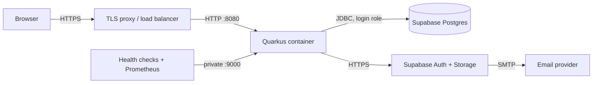

# Deployment Checklist
Hosting-agnostic steps to take GiftLoop live. The host is not chosen yet; CI
already publishes the image (`ghcr.io/colllten/giftloop`, see [CICD.md](CICD.md)).



## 1. Supabase project
- [ ] Create the production project; add its secrets to the GitHub
      `production` environment ([CICD.md](CICD.md#repository-setup-one-time)).
- [ ] Apply migrations: run `deploy-db` (manual dispatch) or merge to `main`.
      Never run `seed.sql` against production.
- [ ] Auth → JWT signing keys: use an asymmetric **ES256** key. The app only
      verifies ES256 tokens via JWKS.
- [ ] Auth → Email: **Confirm email on** (required, see [SECURITY.md](SECURITY.md)),
      OTP length 6, minimum password length 8.
- [ ] Auth → Email templates: copy `database/supabase/templates/sign_in_code.html`
      and the subjects from `config.toml` (magic link, confirmation, recovery).
      Migrations don't carry auth config.
- [ ] Auth → SMTP: set up a custom provider (Postmark, Resend, SES, …).
      Supabase's built-in sender allows only a few emails an hour, and every
      sign-up and code sign-in needs one. The Privacy Policy covers email and
      hosting providers generically; name them if your attorney advises.
- [ ] Auth → Rate limits: Quarkus calls Supabase Auth server-side, so **every
      user shares the app server's IP** for the per-IP limits (sign-in/sign-up,
      verifications, token refresh). Raise them to fit expected traffic.
- [ ] Storage: buckets come from migrations; check `avatars` and `gift-images`
      exist and are private.
- [ ] Backups: confirm the plan's backup schedule (PITR if available).

## 2. Database login role
Locally the pool connects as `postgres`. In production use a role that can only
become `authenticated` (ADR 002). All queries go through `RlsContext`, which
runs `SET LOCAL ROLE authenticated`, so the role needs nothing else.

```sql
create role giftloop_app login noinherit password '<generated>';
grant authenticated to giftloop_app;
```

Connect through the Supabase **session pooler** (IPv4; the direct host is
IPv6-only). Avoid the transaction pooler: the JDBC driver's server-side
prepared statements break on it.

## 3. App container
Environment variables:

| Variable | Value |
|---|---|
| `SUPABASE_URL` | `https://<project>.supabase.co` |
| `SUPABASE_PUBLISHABLE_KEY` | Project publishable key. Keep it server-side (SECURITY.md) |
| `SUPABASE_DB_JDBC_URL` | `jdbc:postgresql://<pooler-host>:5432/postgres?sslmode=require` |
| `SUPABASE_DB_USER` | `giftloop_app.<project-ref>` (pooler user format) |
| `SUPABASE_DB_PASSWORD` | The role's password |
| `GIFTLOOP_CONTACT_EMAIL` | Contact shown in the legal pages. Startup fails without it |

- [ ] Run the `prod` profile (the image default). It turns on JSON logs,
      `Secure` cookies and HSTS.
- [ ] Terminate TLS in front of the app and redirect HTTP to HTTPS. HSTS
      assumes it.
- [ ] Expose only port 8080. Keep 9000 (health, metrics) private (ADR 006).
- [ ] Liveness `:9000/q/health/live`, readiness `:9000/q/health/ready` (checks
      the DB and Supabase Auth).
- [ ] Point a Prometheus scraper at `:9000/q/metrics` and ship stdout logs
      somewhere searchable (error reference IDs are in the `errorId` field).

## 4. Before announcing
- [ ] Attorney review of `/terms`, `/privacy`, `/cookies` ([LEGAL.md](LEGAL.md)).
      Fill in the operator details and contact email.
- [ ] Smoke test on the live URL: sign up (email arrives), onboarding, create a
      group, join from a second account, wishlist, claim, sign out.
- [ ] Check the response headers (`curl -I https://<host>/`) include the CSP
      and HSTS.
- [ ] `v0.1.0` tags the MVP on `main`. Changes merged after it go under a new
      CHANGELOG section and tag.
