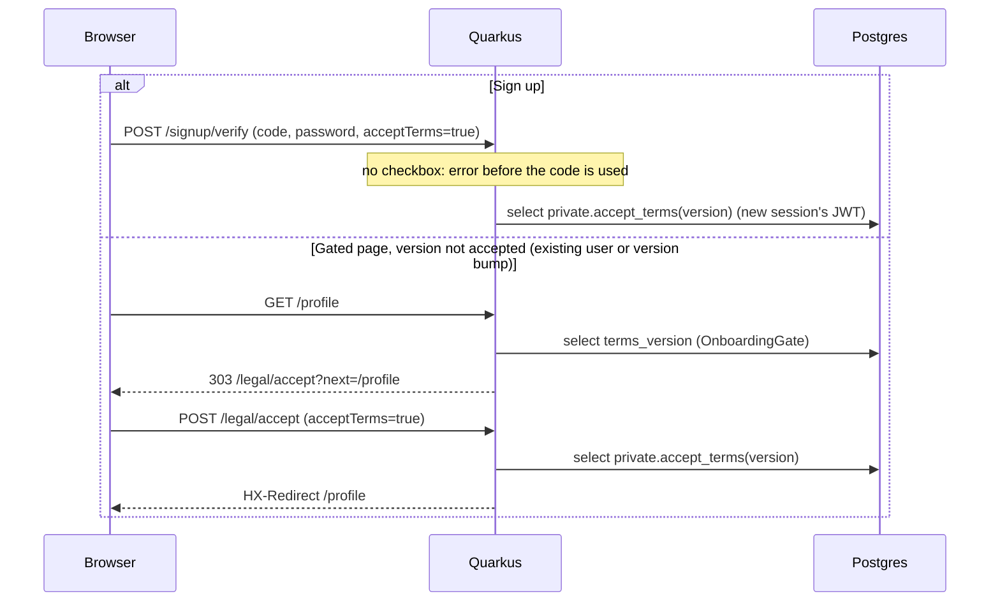

# Legal Documents
Terms of Service, Privacy Policy and Cookie Notice are public Qute pages. They
are drafts written from the code; have an attorney review them before launch.

| Page | Template |
|---|---|
| `/terms` | `web/src/main/resources/templates/LegalResource/terms.html` |
| `/privacy` | `.../LegalResource/privacy.html` |
| `/cookies` | `.../LegalResource/cookies.html` |

Linked from the site footer (`tags/sitefooter.html`, in `base.html`) and the
consent checkbox (`tags/legalconsent.html`).

Config (`application.properties`):
- `giftloop.legal.version`: ISO date shown as "Last updated". Bumping it makes
  every user re-accept.
- `giftloop.legal.contact-email`: `giftloopsupport@gmail.com`, overridable
  with `GIFTLOOP_CONTACT_EMAIL` (tests use `privacy@example.com`).

Operator name: `LegalInfo.OPERATOR`. Governing law: Indiana. Minimum age: 13.

## Acceptance
Stored on `Profile.terms_version` / `terms_accepted_at`, written only by
`private.accept_terms(version)`.

The gate runs on `@RequiresOnboarding` pages only. `/api/*` and `/onboarding`
are not gated; revisit before shipping a mobile/API client.

## When to update
Update the affected page(s) in the same PR when a change touches:

| Change | Documents | Where the facts live |
|---|---|---|
| Personal data collected or stored (new column, bucket, form field) | Privacy | `database/supabase/migrations/` |
| Who can see what (RLS, claim reveal, anonymity, gift visibility) | Privacy, Terms §3–4 | `docs/PRODUCT.md`, `docs/DATABASE.md` |
| Retention or deletion (account deletion, purge, rate-limit pruning) | Privacy §5 | `20261114000004_account_deletion.sql`, `docs/DATABASE.md` |
| Third-party services or processors (hosting, email, OAuth, analytics) | Privacy §4, §8 | `docs/ARCHITECTURE.md` Third-party Integrations |
| Cookies, local/session storage, service workers | Cookies, Privacy §1 | `SessionCookies.java`, `quarkus.rest-csrf.*`, `assets/app.js` |
| Session lifetimes (`jwt_expiry`, refresh max age) | Cookies, Privacy §5 | `config.toml`, `application.properties` |
| Sign-in methods, age rules, eligibility | Terms §1–2, Privacy | `docs/SECURITY.md` |
| Logging of personal data (IPs, emails, content) | Privacy §1 | `com.giftloop.*` loggers |
| Features handling user content or links (auto-fill, sharing) | Terms §5, §7, Privacy §1 | `docs/ARCHITECTURE.md` |
| Group roles and permissions | Terms §3 | `docs/PRODUCT.md` |

For material Terms/Privacy changes, also bump `giftloop.legal.version` and the
seed users' `terms_version` in `database/supabase/seed.sql` (tests assert the
date shown). Wording-only fixes don't need a bump.

Adding cookies or storage that aren't strictly necessary (analytics, ads,
preferences beyond the session) requires a consent banner before they are set.
